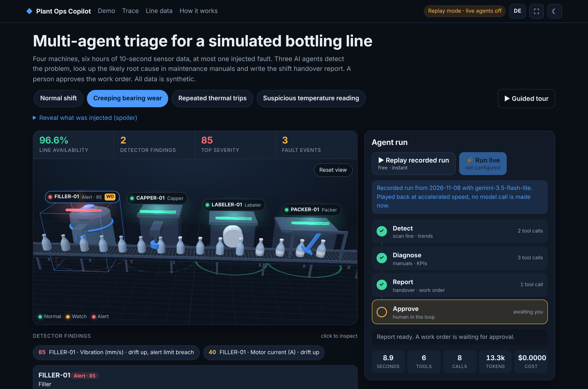
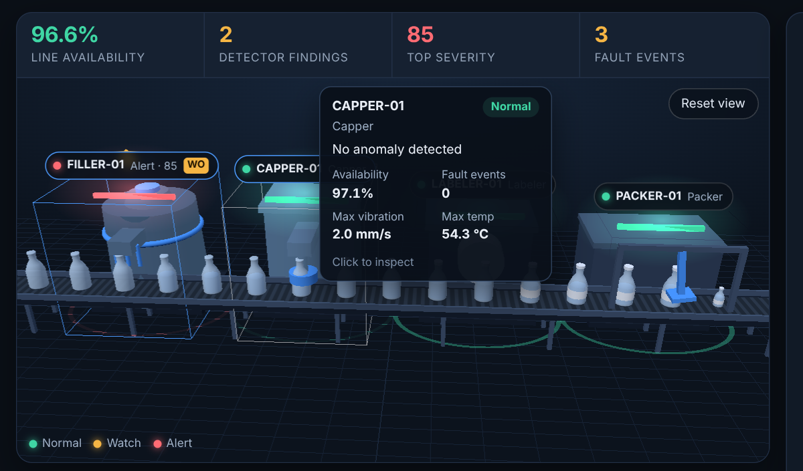
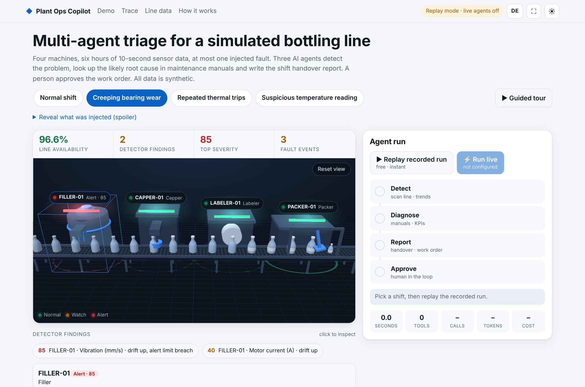
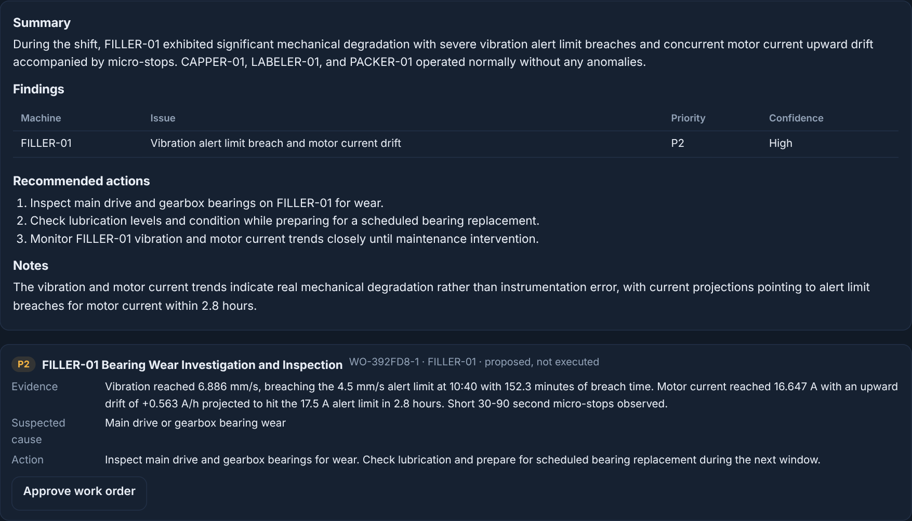
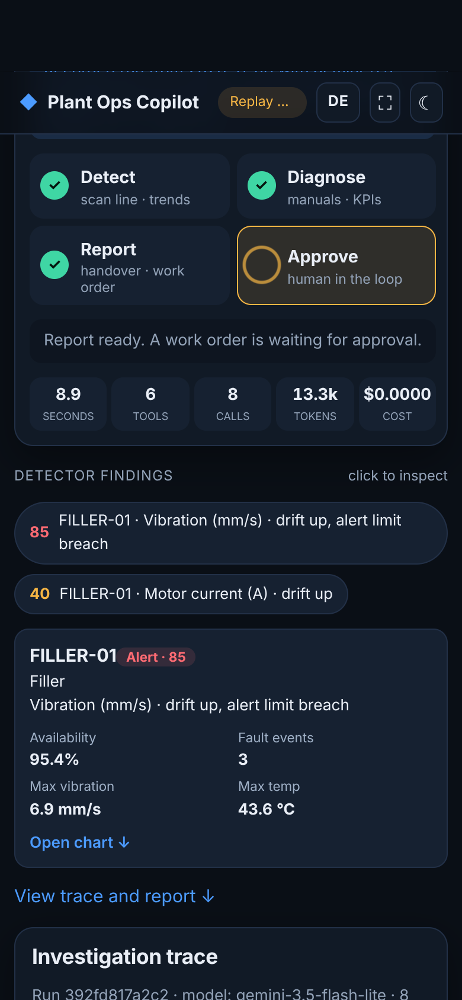

# Plant Ops Copilot

Live demo of agentic AI for manufacturing operations. A simulated bottling line streams sensor data over OPC UA,
dbt models the data in DuckDB, statistical detectors flag anomalies, and a three-agent pipeline (Google ADK)
investigates the findings, cites the maintenance manuals and **proposes** a work order that a person approves.

**Live demo:** [plantops.abhaydev.live](https://plantops.abhaydev.live) · **Source:** [coder-akp/plant-ops-copilot](https://github.com/coder-akp/plant-ops-copilot)

The first visit after an idle period takes a few seconds while the container starts from zero.



## Features
- **3D line view** of the four machines (filler, capper, labeler, packer) with status colours, hover cards and click-to-inspect.
  A 2D view is used where WebGL is unavailable or data saving is on.
- **Live agent progress:** a Detect, Diagnose, Report, Approve pipeline with a "now" line and a run meter (time, tool calls, tokens, cost).
- **Three agents with cited evidence:** the trace shows every tool call and the manual passages behind each finding.
- **Human approval:** the work order is only a proposal until a person approves it.
- **English and German:** the language is part of the agent instructions, so findings, report and work order are written in the
  selected language from the start. Replays are recorded per language.
- **Light and dark theme**, guided tour, presentation mode, and a layout for desktop and mobile.
- **Low latency:** replays are free and instant, data is prefetched, the 3D scene loads after the page is usable.

## Usage
Select a scenario (healthy, bearing wear, overheating, sensor fault), then choose **Replay** (free, instant)
or **Run live** (real model call, rate-limited).

Recorded replays exist per language (`app/replays/<scenario>.json` and `<scenario>.de.json`). A missing German recording
falls back to the English one with a visible notice. Changing the language ends the current run, because its text was
written in the other language.

## Screenshots
| Hover card on a machine | Light theme |
|---|---|
|  |  |

| Line data (computed live, no LLM) | Agent trace (tool calls, citations) |
|---|---|
|  |  |

| Report and proposed work order | Mobile |
|---|---|
|  |   |

## Container image
The image is published to GitHub Container Registry by the workflow in `.github/workflows/build-push.yml`
(tags `latest` and `sha-<commit>`). It runs without any key; without a model the site plays the recorded runs.

```bash
docker run --rm -p 8000:8000 ghcr.io/coder-akp/plant-ops-copilot:latest
```

Open http://localhost:8000. Live runs need `LLM_PROVIDER` and the matching key (see `.env.example`), for example:

```bash
docker run --rm -p 8000:8000 -e LLM_PROVIDER=gemini -e GOOGLE_API_KEY=<key> ghcr.io/coder-akp/plant-ops-copilot:latest
```

## Front end
Plain JavaScript and CSS without a framework. The 3D scene (`app/static/scene.js`, about 130 KB compressed) loads after
the page is usable and is built from `frontend/scene.src.js` with `npm run build` in `frontend/`. Strings live in
`app/static/i18n.js`. The browser check `python -m scripts.e2e_ui <url>` covers both languages, both themes, desktop and mobile.

## Run locally
```bash
pip install -r requirements-dev.txt
python -m scripts.build_data
LLM_PROVIDER=mock uvicorn app.server:create_app --factory   # scripted model, no API key
python -m pytest -q
```
Complete setup including deployment: [docs/START_HERE.md](docs/START_HERE.md) · design: [docs/ARCHITECTURE.md](docs/ARCHITECTURE.md) · cost: [docs/COSTS.md](docs/COSTS.md)

## Limitations
The data is simulated, the manuals are fictional and the security model is demo-grade. LLM output can be wrong,
which is why work orders require human approval.

Built by [Abhay Kumar Patel](https://github.com/coder-akp). MIT licensed.
