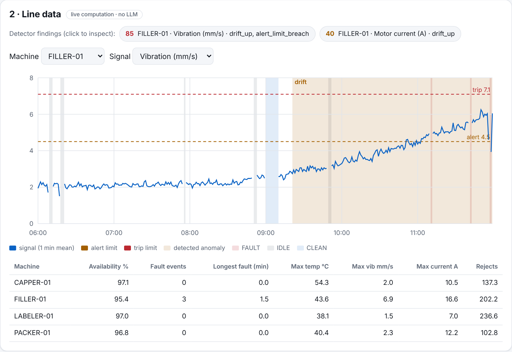
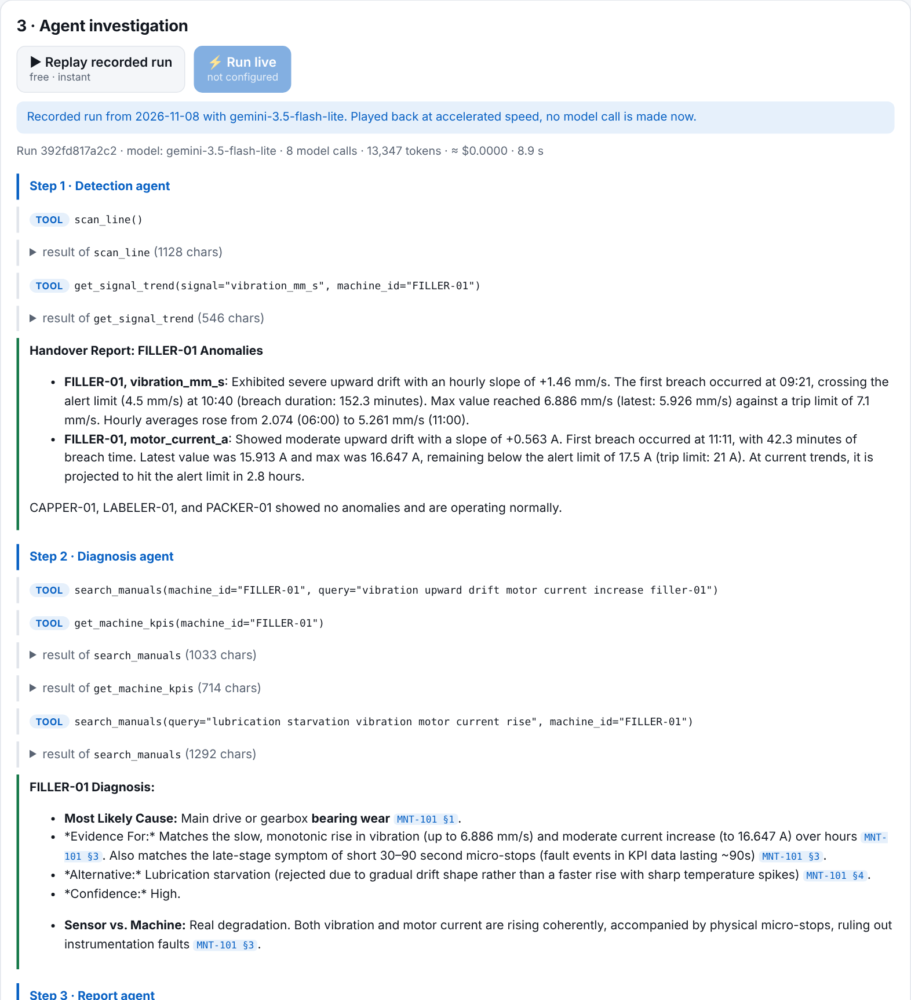
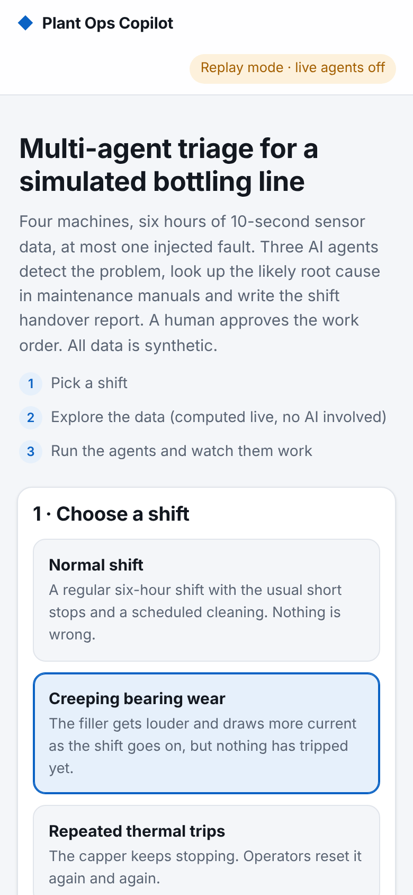

# Plant Ops Copilot

Live demo of agentic AI for manufacturing operations. A simulated bottling line streams sensor data over OPC UA,
dbt models the data in DuckDB, statistical detectors flag anomalies, and a three-agent pipeline (Google ADK)
investigates the findings, cites the maintenance manuals and **proposes** a work order that a person approves.

**Live demo:** [plantops.abhaydev.live](https://plantops.abhaydev.live) · **Source:** [coder-akp/plant-ops-copilot](https://github.com/coder-akp/plant-ops-copilot)

The first visit after an idle period takes a few seconds while the container starts from zero.


## Usage
Select a scenario (healthy, bearing wear, overheating, sensor fault), then choose **Replay** (free, instant)
or **Run live** (real model call, rate-limited).

## Screenshots
| Line data (computed live, no LLM) | Agent trace (tool calls, citations) |
|---|---|
|  |  |

| Report and proposed work order | Mobile |
|---|---|
|  |  |

## Run locally
```bash
pip install -r requirements-dev.txt
python -m scripts.build_data
LLM_PROVIDER=mock uvicorn app.server:create_app --factory   # scripted model, no API key
python -m pytest -q
```
Complete setup including deployment: [docs/START_HERE.md](docs/START_HERE.md) · design: [docs/ARCHITECTURE.md](docs/ARCHITECTURE.md) · cost: [docs/COSTS.md](docs/COSTS.md)

## Limitations
The data is simulated, the manuals are fictional and the security model is demo-grade. LLM output can be wrong,
which is why work orders require human approval.

Built by [Abhay Kumar Patel](https://github.com/coder-akp). MIT licensed.
